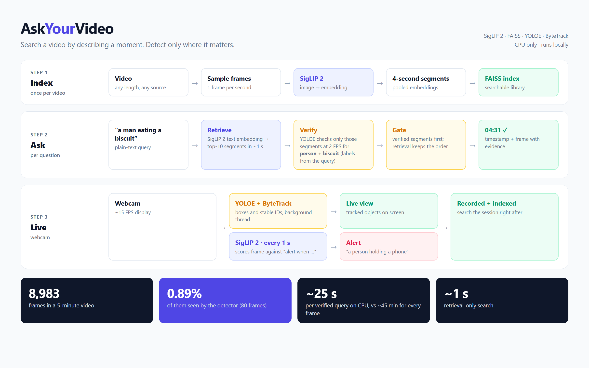

# AskYourVideo

**Find a moment in a video by describing it, and run the expensive detector only where it matters.**



AskYourVideo is a text-to-moment video search system that runs on a laptop CPU. It works in two stages:

1. **Retrieve.** SigLIP 2 embeds one frame per second into 4-second segments indexed with FAISS. A text query returns candidate moments in about a second.
2. **Verify.** An open-vocabulary detector (YOLOE) checks only the top candidates for the objects named in the query, and gates the ranking.

It can also search **what was said** (Whisper transcripts, multilingual-e5 and BM25, combined with rank fusion), run **live on a webcam** (YOLOE + ByteTrack with text-defined alerts), and be used from a **CLI or a Gradio web app**.

## Results

| | |
|---|---|
| Detector workload | **0.89% of frames** (80 of 8,983); measured ≈19 s per verified query on CPU vs. an *estimated* 35–55 min for exhaustive per-frame detection |
| QVHighlights, zero-shot pilot (50 val queries) | **R1@0.5 = 0.56** [95% CI 0.42–0.70] vs. 0.02 for a random-ranking baseline |
| Speech on spoken-only queries | recall@5 0.38 → 0.75 (preliminary, 26 queries) |
| Live webcam mode | ~15 FPS display on CPU |

Negative results are reported too: re-ranking by detector confidence, phonetic Hinglish matching, and equal-weight speech fusion on visual queries all made results worse. The details are in the technical report.

## Quick start

```powershell
cd AskYourVideo
pip install -e ".[ui,speech,dev]"
askvideo index my_video.mp4 -i .askvideo_lib --speech
askvideo search "a man eating a biscuit" -i .askvideo_lib --verify person biscuit --save-frames out\
askvideo-ui                                   # web app at http://127.0.0.1:7860
python -m pytest -q                           # 29 offline tests
```

## Documentation

- [Technical report](AskYourVideo/docs/TECHNICAL_REPORT.md): method, results, ablations, limitations
- [Architecture](AskYourVideo/docs/ARCHITECTURE.md): index-time, inference-time and live diagrams
- [Package README](AskYourVideo/README.md): commands and project layout

## Data and credits

- No videos are included in this repository.
- QVHighlights annotations are © Lei et al. (NeurIPS 2021), CC BY-NC-SA 4.0. `eval/qvh_prepare.py` downloads them along with the released clips.
- Models are used off the shelf: SigLIP 2 (via open_clip), YOLOE (Ultralytics), faster-whisper, and multilingual-e5.
